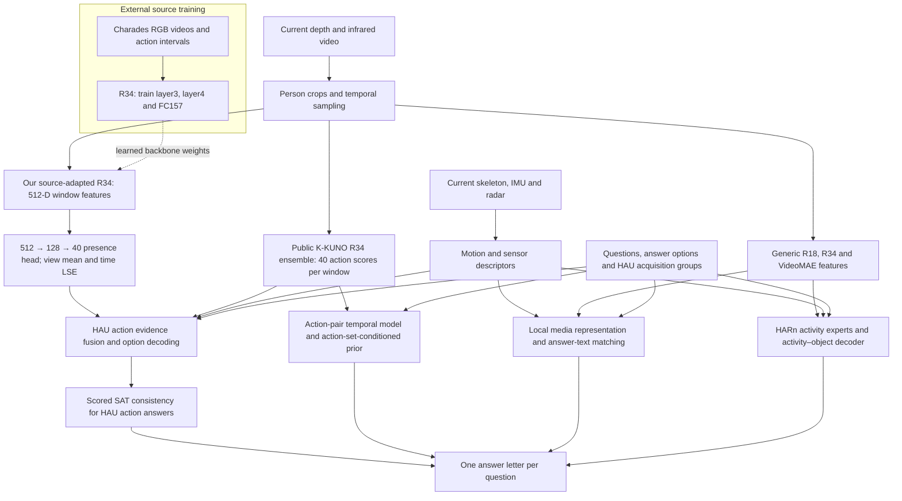

# Method

## Architecture

The diagram shows the primary profile. The secondary adds a paired-source HARn target model and a learned temporal residual. Both use the frozen upstream and downstream components recorded in their profile descriptors.

## Action presence

Our source encoder starts from R(2+1)D-34 pretrained on IG65M and Kinetics. We keep the stem and early stages fixed, update `layer3`, `layer4` and a new 157-class head on Charades, then remove the source classification head. Charades adds supervision for daily indoor actions. Restricting updates to later stages preserves the front-end representation while adapting high-level features.

At target inference, the encoder processes depth-color and infrared views separately. Infrared is replicated to three channels. Eight temporal windows per view each produce a 512-dimensional vector. A shared `Linear(512,128) → GELU → Dropout → Linear(128,40)` head produces window-level action logits. It averages aligned views and uses normalized log-sum-exp over time, with temperature 0.5, to obtain whole-recording action presence. During training, partial HAU labels and an auxiliary HARn action loss supervise this head.

This branch replaces the calibrated presence component within the retained action expert. The public K-KUNO models still supply additional action and temporal evidence. K-KUNO and our source encoder share an R34 architecture family but use different weights, input interfaces and training procedures.

## Temporal order

Order questions provide the four action names to order. The temporal branch reads K-KUNO scores for those action classes across eight long and sixteen short windows. It estimates pairwise order evidence and scores the 24 candidate permutations. A training-count prior conditions on the complete action set, with hierarchical backoff when that set has limited support. The selected D10 configuration combines the temporal model, the prior and available acquisition context.

An action-presence output has already pooled away time. The sequence branch therefore consumes window responses directly, rather than ordering the answers from the single-action questions.

## Emotion and execution style

The local predictor maps sensor and generic video descriptors to a 64-dimensional media vector. Deterministic hashed text features of the question and each answer option are mapped to compatible vectors. Their scores are supervised by the supplied answer labels. A separate context predictor supplies a distribution over legal emotion assignments for the three-recording group. The selected system mixes the local and context distributions with equal weight.

## HARn activity and object

HARn combines R18, R34 and VideoMAE activity experts with equal family weights; the R18 family retains its two-seed average. Available-view masks control aggregation. Activity probabilities, skeleton evidence, option words and activity–object relations jointly determine the answer pair.

## Structured answer decoding

The action expert maps fixed action identities to the actual supplied options for HAU single-action, multiple-action and combination questions. The scored SAT stage enforces their shared action constraints. It first minimizes changes to the proposed answers, then uses model probabilities to resolve ties. It operates on action questions; the sequence, emotion and HARn branches have their own task-specific decoders.

## Code map

| Mechanism | Main implementation |
|---|---|
| End-to-end entry | `src/predict.py` |
| Source encoder training | `core/scripts/train_charades_r34_source.py` |
| HAU head and LSE | `core/src/cuhkx/action_variable_window_head.py` |
| Primary branch inference | `core/scripts/selection_source_presence.py`, `selection_action.py` |
| Temporal prior | `core/src/cuhkx/server_temporal_d10_backoff.py` |
| Local media–text model | `core/src/cuhkx/local_emotion_student.py` |
| HARn family fusion | `core/scripts/infer_harn_three_family_v2.py` |
| Final scored consistency | `core/scripts/apply_explicit_group_sat.py` |
